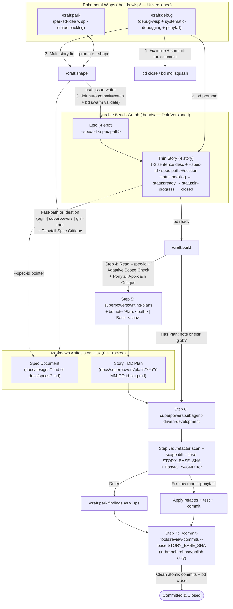

# Restructuring the `craft` Plugin Around Four Workshop Verbs (`park` · `debug` · `shape` · `build`)

* **Status**: Approved (Post-EGM Review Pass 2)
* **Author**: Karthik Subramanian
* **Created**: 2026-11-07
* **Updated**: 2026-11-07

---

## Overview

The `craft` plugin (`skills/craft/`, `agents/craft/`, `hooks/craft/`, `templates/craft/`, and `registry.json`) orchestrates end-to-end software development backed by the `beads` (`bd`) issue tracker. This design restructures `craft` from ten fragmented skills and three agents into **four user-facing workshop commands**—`/craft:park`, `/craft:debug`, `/craft:shape`, and `/craft:build`—and **one graph-creation agent** (`craft:issue-writer`). By combining `bd` v0.60+ native primitives (`--ephemeral` wisps, `--spec-id` links, `bd set-state` swimlanes, `bd promote`, `bd mol squash`, `bd mol burn`, `bd note`, and `bd swarm validate`) with runtime delegation to existing specialist skills (`egm`, `superpowers`, `grill-me`, `ponytail`, `refactor`, and `commit-tools`), `craft` eliminates static framework drift, multi-page issue bloat, and stateful multi-session handoffs.

## The Problem

1. **Bloated Beads Issues and Two-Phase Duplication**: Currently, `skills/craft/decompose/SKILL.md` and `agents/craft/issue-writer.md` embed full multi-step implementation plans, code snippets, and copied design paragraphs directly inside each Beads issue (`--description`, `--design`, `--acceptance`). When a developer later edits code or updates a design doc, downstream Beads issues go stale and waste context tokens in every session that runs `bd show`.
2. **Static Copies of External Frameworks Drift Out of Sync**: `skills/craft/decompose/frameworks/{builtin,superpowers,speckit,bmad}.md` maintain hardcoded summaries of third-party methodologies, and `agents/craft/{spec-reviewer,quality-reviewer}.md` duplicate review loops that `superpowers:subagent-driven-development` and `ponytail` already provide natively.
3. **Fragmented and Mechanical Command Surface**: Shipping ten separate skills (`decompose`, `execute`, `understand`, `epic`, `deps`, `task`, `backlog`, `park`, `parked`, `task-commit`) forces the user to remember low-level CLI wrappers (`epic`, `deps`, `parked`, `backlog`, `task`) and provides no dedicated path for root-cause bug investigation or per-story TDD plan expansion when resuming work in a new session.
4. **Sequential CLI Execution Causes Dolt Write Amplification**: Creating an epic with $N$ tasks and $M$ dependencies via sequential `bd create` and `bd dep add` calls triggers $N + M + 1$ separate Dolt transactions unless batched.

### Why Now / Why This Matters

- **Beads v0.60+ Primitives Are Available**: `bd` now natively supports ephemeral wisps in `.beads-wisp/` (`--ephemeral`, `bd mol wisp list`, `bd promote`, `bd mol squash`, `bd mol burn`), first-class specification links (`--spec-id`), append-safe notes (`bd note`), operational swimlane labels (`bd set-state <id> status=<lane>`), and batched Dolt commits (`--dolt-auto-commit=batch` + `bd swarm validate`).
- **Specialist Plugins Are Installed in the Ecosystem**: Ideation (`egm`, `superpowers:brainstorming`, `grill-me`), YAGNI/architecture proportion (`ponytail`, `ponytail:ponytail-review`), debugging (`superpowers:systematic-debugging`), TDD execution (`superpowers:writing-plans`, `superpowers:subagent-driven-development`), refactoring analysis (`refactor:scan`), and commit hygiene (`commit-tools:commit`, `commit-tools:review-commits`) can be invoked directly at runtime rather than re-implemented inside `craft`.
- **15 Legacy Files Can Be Pruned**: Consolidating to the four workshop verbs allows deleting 9 legacy skill markdown files, 4 static framework files, and 2 duplicate reviewer agents (15 files across 9 skill directories and 2 agent files).

## Goals

- Keep `bd` stories thin (`1–2` sentence `--description` + `--spec-id "<spec-path>#<section>"` pointer + concise `Touch:` and `Verify:` lines) with zero copied code blocks or multi-step implementation plans stored inside `.beads/`.
- Consolidate `craft` to four user-invocable commands—`craft/park`, `craft/debug`, `craft/shape`, and `craft/build`—and one agent (`agents/craft/issue-writer.md`), folding `task-commit`'s two-sentence commit-context rule directly into `build` and `debug`.
- Track story progress across four hyphenated swimlanes (`status:backlog` → `status:ready` → `status:in-progress` → `closed`) via `bd set-state <id> status=<lane>` alongside standard `bd` statuses.
- Guarantee wisp visibility across `/craft:park list`, `/craft:build` status headers, Adaptive Scope checks, and the session-end `Stop` hook (`hooks/craft/scripts/check-parked-ideas.sh`).
- Support cross-session resumption in `/craft:build`, Adaptive Scope inclusion of closely related ready stories or parked wisps, and a post-story `/refactor:scan` (filtered through `ponytail` so only high-leverage, non-YAGNI simplifications are fixed or parked) + `/commit-tools:review-commits` polish pipeline.
- Author all four `SKILL.md` files and `issue-writer.md` following minimal-instruction, anti-bloat standards (`<= 250–400 words` per skill, trigger-only `Use when...` descriptions, positive output templates) and pass `npm run build`, `npm run validate`, and `npm test`.

## Non-Goals

- Changing the plugin name `craft` or modifying the `bd` CLI binary.
- Modifying the core workflow logic of `superpowers`, `egm`, `ponytail`, `refactor`, or `grill-me` (only updating three literal `/craft:decompose` example strings in `skills/commit-tools/commit/` to `/craft:shape` and updating `templates/commit-tools/README.md` and `templates/refactor/README.md`).
- Supporting `speckit` or `bmad` static decomposition templates.
- Automating `git push`, `bd sync`, or `bd dolt push` (remote synchronization remains owned by the user per `AGENTS.md`).

## Open Questions

*None. All architectural, UX, swimlane, adaptive-scoping, refactor-scan + ponytail, and commit-review decisions have been resolved.*

---

## Critical User Journeys (CUJs)

### CUJ 1: Mid-Flow Quick Thought Capture and Visibility (`/craft:park`)
- **When**: A developer is mid-implementation on a story and thinks of an orthogonal improvement or edge case.
- **Action**: The developer runs `/craft:park "Refactor token cache expiry"` (or `/craft:park list`, `/craft:park promote <id> [--shape]`, `/craft:park drop <id>`).
- **Then**: `/craft:park` captures the thought as an ephemeral wisp (`bd create --ephemeral -l parked-idea -l status:backlog`, linked via `--deps discovered-from:<active-id>` when an active story exists) without polluting `.beads/` Dolt history. The parked wisp remains visible in `/craft:park list`, in `/craft:build`'s status header and Adaptive Scope check, and in the `Stop` hook (`hooks/craft/scripts/check-parked-ideas.sh`) when the session ends.

### CUJ 2: Root-Cause Bug Investigation (`/craft:debug`)
- **When**: A developer encounters a failing test, regression, or production bug symptom.
- **Action**: The developer runs `/craft:debug "Flaky race in webhook retry"` (or passes an existing bug ID).
- **Then**: `/craft:debug` creates an ephemeral diagnostic wisp (`bd create --ephemeral -t bug -l debug-wisp`), runs `superpowers:systematic-debugging` combined with a `ponytail` caller trace (*"grep every caller of the broken function and fix the root cause once in shared code"*), and appends findings via `bd note`. Once the root cause is isolated, the developer chooses one of four exits:
  1. **Fix inline now**: Implement the minimal fix + regression test, commit atomically via `/commit-tools:commit` (passing the bug root-cause context without leaking `bd-xxx` IDs), and close/squash the wisp (`bd close <wisp-id> --reason "Fixed: <root-cause>"` or `bd mol squash <wisp-id>`).
  2. **Promote to a tracked bug**: Run `bd promote <wisp-id> --reason "Root cause isolated"` + `bd set-state <id> status=ready` to build later via `/craft:build <id>`.
  3. **Promote & Shape**: Promote the wisp and hand off to `/craft:shape` if the fix spans multiple stories.
  4. **Discard (false alarm)**: Run `bd mol burn <wisp-id> --force`.

### CUJ 3: Spec-Driven Feature Shaping into Thin Beads Stories (`/craft:shape`)
- **When**: A developer wants to turn a feature idea, promoted wisp, or design doc into trackable work.
- **Action**: The developer runs `/craft:shape` (with an optional description or spec file path).
- **Then**:
  - If brainstorming was already completed in the current session or a spec path on disk was passed, `/craft:shape` fast-paths straight to spec critique and story slicing.
  - Otherwise, `/craft:shape` asks which available ideation workflow to run (`egm`, `superpowers:brainstorming` stopping after spec approval, or `grill-me`) and produces the approved markdown spec on disk.
  - `/craft:shape` runs a `ponytail` / `ponytail:ponytail-review` critique on the spec (unless just reviewed by `egm-review`), slices the spec into a thin Epic and cohesive vertical-slice Stories (`1–2` sentence description + `--spec-id "<spec-path>#<section>"`), gets user confirmation on the story graph preview, and dispatches `craft:issue-writer` to create the Epic, Stories, `status:ready` / `status:backlog` swimlanes, and dependencies in a batched Dolt commit validated by `bd swarm validate <epic-id>`.

### CUJ 4: Picking, Adaptive Scoping, Planning, and Building a Story or Epic (`/craft:build`)
- **When**: A developer starts a new session or is ready to implement shaped work.
- **Action**: The developer runs `/craft:build` (with no arguments) or `/craft:build <story-id|epic-id>`.
- **Then**:
  - **Steps 1–2 — Work Selection**: If no ID is passed, `/craft:build` displays an interactive picker organized by swimlane: (1) active `status:in-progress` stories (resumable), (2) active Epics with completion/ready counts, (3) standalone `status:ready` stories (`bd ready`), and (4) a count of active parked wisps in `.beads-wisp/`. If an Epic ID is selected, `/craft:build` picks the next ready story (`bd ready --parent <epic-id>`).
  - **Step 3 — Claim & Resumption Check**: Claims the story (`bd update <id> --claim` + `bd set-state <id> status=in-progress`). If the story already has `Plan: <plan-path> | Base: <sha>` in its notes (or a matching `docs/superpowers/plans/*-<id>-*.md` file on disk), `/craft:build` skips Steps 4–5 and resumes `superpowers:subagent-driven-development` from the first unfinished task.
  - **Step 4 — Approach, Ponytail Critique & Adaptive Scope Check**: Otherwise, `/craft:build` reads the linked `--spec-id` section and `Touch:` files, and scans other `ready` stories and `parked-idea` wisps for items touching the same files or seams. If closely related items exist, `/craft:build` offers to bundle them into the current build scope. It then presents the concise Ponytail-critiqued technical approach for user approval.
  - **Step 5 — TDD Plan**: Once the approach is approved, `/craft:build` invokes `superpowers:writing-plans` to write `docs/superpowers/plans/YYYY-MM-DD-<id>-<slug>.md` (tagging tasks by story ID `[bd-xxx]`) and records `bd note <id> "Plan: <path> | Base: $(git rev-parse HEAD)"` on the story (and any bundled story).
  - **Step 6 — Subagent Execution**: `/craft:build` executes the plan via `superpowers:subagent-driven-development` (committing completed tasks via `/commit-tools:commit` without `bd-xxx` IDs).
  - **Step 7 — Post-Story `/refactor:scan` + `ponytail` Filter & `/commit-tools:review-commits` Polish**:
    1. Runs `/refactor:scan --scope diff --base "$STORY_BASE_SHA"` (stopping after candidate detection without creating persistent `.beads/` issues) and filters the candidates through `ponytail:ponytail` / `ponytail:ponytail-review` (discarding YAGNI abstractions and keeping only genuine deduplication, caller unification, or simplification wins).
    2. If Ponytail-approved findings remain, asks the user whether to **Fix now** (apply the minimal refactoring under `ponytail`, re-run tests, and commit via `/commit-tools:commit` so it folds into the story's commits) or **Park for later** (capture each finding as an ephemeral wisp via `/craft:park` linked with `discovered-from:<id>`).
    3. Runs `/commit-tools:review-commits --base "$STORY_BASE_SHA"` (in-branch Steps 1–7 only, without merging to `main` or deleting the branch) to squash/split and polish the story's commits (including any folded refactoring fixes) into clean atomic commits with the story's `why` context, closes the story (`bd close <id>`), and reconciles newly unblocked stories on the Epic's Ready Front to `status=ready`.

---

## Technical Plan (Architecture)

### 1. System Architecture & Lifecycle Data Flow

The architecture separates **ephemeral exploration** (`.beads-wisp/`, excluded from Dolt commit history), **durable thin coordination** (`.beads/`, tracking the Epic/Story DAG, swimlanes, and pointers), and **markdown artifacts on disk** (`docs/designs/` or `docs/specs/` for specifications, `docs/superpowers/plans/` for per-story TDD plans).



### 2. Beads Data Model & Swimlane Schema Contract

Stories move through four hyphenated swimlanes managed via `bd set-state <id> status=<lane>`:
- **`status:backlog`** — Parked wisps in `.beads-wisp/`, promoted unshaped ideas (`--status=deferred`), or shaped stories blocked by upstream dependencies.
- **`status:ready`** — Shaped stories (`--spec-id` attached) with zero open blockers (`bd ready`), ready for `/craft:build`.
- **`status:in-progress`** — Claimed by `/craft:build` (`bd update <id> --claim` + `bd set-state <id> status=in-progress`).
- **`closed`** — Implemented, verified, and committed (`bd close <id>`).

#### Swimlane & Native `bd` Status Reconciliation Rules
1. **Unshaped Promoted Wisps Stay Out of `bd ready`**: When `/craft:park promote <id>` promotes a wisp without `--shape`, it sets `bd update <id> --defer +30d` alongside `bd set-state <id> status=backlog` so the unshaped idea does not appear in `bd ready` until shaped by `/craft:shape`.
2. **Automatic Unblocking Updates Swimlane to `status:ready`**: Whenever `/craft:build` queries `bd ready` (Steps 1–2) or closes a story (Step 7), any newly unblocked story returned by `bd ready` that still carries `status:backlog` is updated via `bd set-state <id> status=ready`.

#### Positive Slot Template for Thin Stories (Enforced by `craft:shape` and `craft:issue-writer`)

Instead of embedding code blocks or multi-step implementation plans in `.beads/`, every Epic and Story created by `craft:issue-writer` follows this exact positive slot template:

```text
Epic (-t epic):
  --title "<Epic Title>"
  --description "<1-2 sentence architectural goal and user outcome>"
  --spec-id "<spec-path>"
  -l "status:ready"

Story (-t story):
  --parent "<epic-id>"
  --title "<Vertical Slice Story Title>"
  --description "<1-2 sentence user/system outcome delivered by this slice>"
  --spec-id "<spec-path>#<section-anchor>"
  --design "Touch: <comma-separated file paths or module seams>"
  --acceptance "Verify: <1-3 runnable test/validation commands>"
  --deps "blocked-by:<upstream-story-id>"   # or via bd dep add <story-id> <upstream-id>
  -l "status:ready"                         # or "status:backlog" if blocked-by is non-empty
```

To prevent Dolt write amplification (NFR 1), `craft:issue-writer` executes all `bd create` and `bd dep add` calls with `--dolt-auto-commit=batch`, commits the batch in a single transaction via `bd dolt commit`, and runs `bd swarm validate <epic-id>`.

### 3. Component Specifications

#### 3.1 `/craft:park` (`skills/craft/park/SKILL.md`)
- **Arguments**: `[idea | list | promote <id...> | drop <id...> | review] [--task|-t <id>] [--priority|-p 0-4] [--shape] [--force|-f]`
- **Behavior**:
  - **Capture (default when `<idea>` text is passed)**: Checks `bd list --status=in_progress --json` for an active bead. Creates an ephemeral wisp:
    - If an active `<active-id>` exists: `bd create "<title>" -d "<1-sentence context>" -p <priority> --ephemeral -l parked-idea -l status:backlog --deps discovered-from:<active-id> --json`
    - If no active bead exists: omits `--deps discovered-from:...`.
    - Prints a 1-line confirmation (`Parked wisp <id>: "<title>"`) and immediately returns focus to the current task.
  - **`list`**: Runs `bd mol wisp list --json`, filters to open items labeled `parked-idea`, and renders a table showing `ID`, `Priority`, `Title`, `Origin`, and `Age`.
  - **`promote <id...> [--shape]`**: Runs `bd promote <id> --reason "Promoted from parked wisp"` (preserving the original issue ID). If `--shape` is passed, hands the promoted bead directly to `/craft:shape <id>`; otherwise sets `bd update <id> --defer +30d` and `bd set-state <id> status=backlog` so it stays in the backlog lane until shaped.
  - **`drop <id...> [--force|-f]`**: Confirms with a single prompt (unless `--force`), then discards the wisp via `bd mol burn <id> --force`.
  - **`review`**: Loops through each active `parked-idea` wisp one at a time using a single-question prompt (`Promote to backlog`, `Promote & shape now`, `Drop`, `Skip`).

#### 3.2 `/craft:debug` (`skills/craft/debug/SKILL.md`)
- **Arguments**: `[symptom-or-id] [--task|-t <id>]`
- **Behavior**:
  - **Step 1 — Spawn or Attach Diagnostic Wisp**: If an existing issue ID is passed, attaches to it (`bd show <id> --json`); otherwise creates an ephemeral bug wisp (`bd create "Investigate: <symptom>" -t bug --ephemeral -l debug-wisp --json`, adding `--deps discovered-from:<active-id>` if an active task exists).
  - **Step 2 — Root-Cause Investigation**: Invokes `superpowers:systematic-debugging` to reproduce the failure, trace data flow backward, and form a single hypothesis. Logs each hypothesis and result via `bd note <wisp-id> "Hypothesis: ... Result: ..."`.
  - **Step 3 — Ponytail Caller & Blast-Radius Trace**: Applies `ponytail:ponytail` (or a 3-line inline caller trace if `ponytail` is not installed): greps all callers of the affected function/module to confirm whether the bug is an isolated defect or a shared contract flaw, and defines the smallest root-cause fix in shared code. Appends `bd note <wisp-id> "Root cause: <file:line> — <summary>. Callers checked: <list>"`.
  - **Step 4 — Resolution Exit**: Prompts the user with a single choice:
    1. **Fix inline now**: Implement the minimal fix + regression test, invoke `/commit-tools:commit` with the root-cause context (never including `bd-xxx` IDs in the commit message), and close the wisp (`bd close <wisp-id> --reason "Fixed: <root-cause>"`, or `bd mol squash <wisp-id> --summary "Fixed: <root-cause>"` if child wisps were spawned).
    2. **Promote to tracked bug**: Run `bd promote <wisp-id> --reason "Root cause isolated; queued for /craft:build"` and `bd set-state <wisp-id> status=ready`.
    3. **Promote & Shape**: Promote the wisp (`bd promote <wisp-id>`) and invoke `/craft:shape` with the root-cause notes.
    4. **Discard (false alarm)**: Run `bd mol burn <wisp-id> --force`.

#### 3.3 `/craft:shape` (`skills/craft/shape/SKILL.md`)
- **Arguments**: `[feature-or-spec] [--with egm|superpowers|grill-me] [--dry-run|-d]`
- **Behavior**:
  - **Step 1 — Spec Acquisition (Fast-Path or Ideation Selector)**:
    - **Fast-Path**: If the user passes a markdown spec path on disk, or if a design doc was already created/approved earlier in the current conversation, `/craft:shape` skips ideation and uses that spec directly.
    - **Ideation Selector**: Otherwise (unless `--with` is explicitly passed), checks which ideation skills are available in the active session and prompts the user to select one:
      - `egm`: Runs `/egm-brainstorm` → `/egm-draft` (and optional `/egm-review`), producing `docs/designs/<slug>.md`.
      - `superpowers`: Runs `superpowers:brainstorming`, producing `docs/superpowers/specs/YYYY-MM-DD-<slug>-design.md`. **Caller Override Rule**: Treats user approval of the written spec file on disk as the completion signal returning control immediately to `/craft:shape` Step 2 (explicitly superseding `brainstorming`'s default terminal transition to `superpowers:writing-plans`).
      - `grill-me`: Runs `/grill-me` and writes the resulting decisions and architecture to `docs/specs/YYYY-MM-DD-<slug>-design.md`.
      - *Fallback*: If none of those three external plugins is installed, runs a concise 3-question Socratic interview and writes `docs/specs/YYYY-MM-DD-<slug>-design.md`.
  - **Step 2 — Ponytail Spec Critique (Proportion & YAGNI Gate)**:
    - Skipped if the spec was just reviewed by `/egm-review` (which already runs the Skeptical Architect Zoom-Out audit).
    - Otherwise applies `ponytail:ponytail` / `ponytail:ponytail-review` to the spec (checking existing codebase utilities to reuse, eliminating speculative abstractions, and merging micro-concerns). Updates the spec file on disk with any approved simplifications.
  - **Step 3 — Vertical-Slice Story Slicing & Preview**:
    - Slices the spec into 1 Epic and $N$ cohesive, user-testable vertical Stories following the Positive Slot Template in Section 2.
    - Displays the proposed Epic, Stories (with `--spec-id` anchors, `Touch:` files, `Verify:` commands, and `status:ready` / `status:backlog` swimlanes), and dependency DAG for user approval (or exits after preview if `--dry-run`).
  - **Step 4 — Batched Graph Creation**:
    - Dispatches `craft:issue-writer` (`agents/craft/issue-writer.md`) to create the Epic, Stories, dependencies, and swimlane labels using `--dolt-auto-commit=batch`, commit once via `bd dolt commit`, and validate the DAG via `bd swarm validate <epic-id>`.

#### 3.4 `/craft:build` (`skills/craft/build/SKILL.md`)
- **Arguments**: `[story-id|epic-id] [--auto|-a] [--no-commit]`
- **Behavior**:
  - **Step 1 — Interactive Work Picker (when no ID is passed)**:
    - Queries `bd list --status=in_progress --json`, `bd ready --json`, and `bd mol wisp list --json` (filtered to `parked-idea`). Reconciles any `bd ready` story still labeled `status:backlog` to `bd set-state <id> status=ready`.
    - Displays a status header organized by swimlane (`status:in-progress`, `status:ready`, `status:backlog` parked wisps) and prompts the user to select:
      1. Any active `status:in-progress` story (marked `[Resumable — Plan ready]` if a `Plan:` note or `docs/superpowers/plans/*-<id>-*.md` file exists).
      2. Active Epics (showing `<closed>/<total> stories done, <ready> ready`).
      3. Standalone `status:ready` stories (`bd ready`).
  - **Step 2 — Epic Ready-Front Traversal (when an Epic ID is passed or picked)**:
    - Queries `bd ready --parent <epic-id> --json` and selects the next unblocked story on the Epic's Ready Front.
  - **Step 3 — Claim & Fast-Resumption Check**:
    - Claims the story via `bd update <id> --claim` and sets `bd set-state <id> status=in-progress`.
    - Checks `bd show <id> --json` notes for `Plan: <plan-path> | Base: <sha>` (with a disk glob fallback `docs/superpowers/plans/*-<id>-*.md`). If the plan file exists on disk, restores `STORY_BASE_SHA` from `Base: <sha>` (falling back to `git merge-base HEAD main`), skips Steps 4 and 5, and jumps directly to Step 6 (`superpowers:subagent-driven-development`), resuming from the first unfinished task in the plan.
  - **Step 4 — Spec Expansion, Adaptive Scope Check & Ponytail Approach Critique**:
    - Reads the story's `--spec-id` (`<spec-path>#<section>`) and the target code files listed in `Touch:`.
    - **Adaptive Scope Check**: Scans other `status:ready` stories (`bd ready --json`) and `parked-idea` wisps (`bd mol wisp list --json`) for items that touch the same files or module seams. If closely related items are found, asks the user (unless `--auto`): *"Story/wisp `<other-id>` (`<title>`) touches the same files/seam. Include it in this build scope?"* If accepted, promotes any selected wisp (`bd promote`), claims the bundled story (`bd update <other-id> --claim`), and sets `bd set-state <other-id> status=in-progress`.
    - Drafts the technical approach for the active scope and critiques it with `ponytail:ponytail` / `ponytail:ponytail-review` (verifying callers, edge cases, and reuse). Presents the concise approach for user approval (unless `--auto`).
  - **Step 5 — Story TDD Plan Generation**:
    - Invokes `superpowers:writing-plans` (with `ponytail:ponytail` active so every line of planned code is minimal and proportional) to write `docs/superpowers/plans/YYYY-MM-DD-<id>-<slug>.md`.
    - Tags each task in the plan with its story ID (`### Task N [bd-xxx]: ...`).
    - Records the plan path and current base commit SHA (`STORY_BASE_SHA=$(git rev-parse HEAD)`) on the primary story and any bundled stories:
      ```bash
      bd note <id> "Plan: docs/superpowers/plans/YYYY-MM-DD-<id>-<slug>.md | Base: $(git rev-parse HEAD)"
      ```
  - **Step 6 — Subagent Execution**:
    - Invokes `superpowers:subagent-driven-development` on the story plan file (falling back to `superpowers:executing-plans` if subagents are unavailable in the harness).
    - **Caller Override Rules for SDD**:
      1. Subagents commit each completed task via `/commit-tools:commit` (never raw `git commit` if `commit-tools` is active, and never including `bd-xxx` tracker IDs in commit messages).
      2. Suppresses `superpowers:finishing-a-development-branch` after individual stories so Step 7 and multi-story Epic loops run cleanly.
  - **Step 7 — Post-Story Refactor Scan (`+ Ponytail`), Commit Review & Closure**:
    - Once all tasks in the story plan pass verification (unless `--no-commit` is set):
      1. **Refactor Scan (`/refactor:scan`) + Ponytail Filter (`ponytail:ponytail`)**:
         - Runs `/refactor:scan --scope diff --base "$STORY_BASE_SHA"`. **Caller Override Rule for `/refactor:scan`**: Stops after candidate verification (`refactor-scanner` / source check) and **suppresses `bd create` in `refactor-validator` Step 4** so persistent `.beads/` issues are not auto-created mid-build.
         - Filters all detected refactoring candidates through `ponytail:ponytail` / `ponytail:ponytail-review` to eliminate YAGNI abstractions (e.g., premature interfaces, single-caller helpers, or speculative splits) and retain only high-leverage simplifications (deduplicating real repeated logic, unifying callers in shared code, or removing dead code).
      2. **Fix Now or Park Decision**: If Ponytail-approved refactoring findings remain, prompts the user:
         - **Fix now & fold into commit**: Applies the selected refactoring improvements under `ponytail:ponytail` (smallest clean change), runs the story's verification tests to confirm green, and commits via `/commit-tools:commit` so the next step folds them cleanly.
         - **Park findings for later**: Captures each finding as an ephemeral wisp via `/craft:park` (`bd create --ephemeral -l parked-idea -l status:backlog --deps discovered-from:<id>`) rather than filing durable issues mid-build.
      3. **Commit Hygiene & Squash/Split Polish (`/commit-tools:review-commits`)**:
         - Runs `/commit-tools:review-commits --base "$STORY_BASE_SHA"`. **Caller Override Rule for `/commit-tools:review-commits`**: Executes only the in-branch commit hygiene analysis, plan approval, rebase execution, revalidation, and `validate-commits` checks on `$STORY_BASE_SHA..HEAD` (Steps 1–7), **suppressing Step 8 (Merge to Main), Step 9 (Tag), and Step 10's branch/worktree deletion** so the worktree stays on the active branch.
         - Reviews all commits created during the story (including any refactoring fixes just applied), folding/squashing noisy task commits or splitting distinct logical units into clean, atomic commits including the story's `why` context (and zero `bd-xxx` ID leaks).
    - Closes the completed story (and any bundled stories) via `bd close <id> --reason "Completed"`, and reconciles any newly unblocked stories on the Epic's Ready Front (`bd ready --parent <epic-id>`) via `bd set-state <next-id> status=ready`.
    - If building an Epic, loops back to Step 2 for the next newly unblocked story on `bd ready --parent <epic-id>` (prompting before continuing unless `--auto` is set).

#### 3.5 Stop Hook Update (`hooks/craft/scripts/check-parked-ideas.sh`)
- Removes the broken `git log -1` `COMMIT_MSG` / `TASK_ID` regex gate (lines 12–20 of the existing script, which previously caused the hook to silently `exit 0` whenever commit messages excluded Beads task IDs).
- Queries `bd mol wisp list --json 2>/dev/null || exit 0`, normalizes both list (`[...]`) and dict (`{"wisps": [...]}`) JSON shapes in `python3`, filters to open wisps carrying the `parked-idea` label (excluding `debug-wisp`), and surfaces a `systemMessage` reminder at session end listing parked wisps and suggesting `/craft:park review` or `/craft:park promote <id> --shape`.

---

## Alternatives Considered

### Alternative A: Keep Static Framework Templates (`skills/craft/decompose/frameworks/*.md`)
- **Pros**: No runtime dependency on external brainstorming skills.
- **Cons**: Static prompt copies of `superpowers`, `speckit`, and `bmad` drift from upstream skills, bloat the plugin by ~400 lines, and encourage dumping entire plans into Beads issues.
- **Reason for Rejection**: Rejected by author: delegating directly to live skills (`egm`, `superpowers:brainstorming`, `grill-me`, `ponytail`) with a lightweight inline Socratic fallback eliminates maintenance drift.

### Alternative B: Generate Full TDD Plans for All Stories Upfront During `/craft:shape`
- **Pros**: Every story has a step-by-step plan before any code is written.
- **Cons**: Early stories routinely alter file signatures and helpers, invalidating TDD plans written upfront for later stories in the DAG.
- **Reason for Rejection**: Rejected by author: Just-in-Time (JIT) story expansion during `/craft:build` ensures each story's TDD plan is written against the actual current state of the codebase.

### Alternative C: Retain Legacy `decompose`, `execute`, `epic`, `deps`, `task`, `backlog`, `parked`, and `task-commit` Skills
- **Pros**: Familiar command names for existing v2/v3 users.
- **Cons**: Requires maintaining 10 skills for overlapping workflows (`park` vs `parked`, `execute` vs `task` vs `backlog`, `decompose` vs `understand` vs `epic` vs `deps`) plus a separate 23-line `task-commit` skill whose 2-sentence rule belongs directly inside `build` and `debug`.
- **Reason for Rejection**: Rejected by author: the four workshop verbs (`park`, `debug`, `shape`, `build`) map 1:1 to developer intent.

### Alternative D: Keep `spec-reviewer.md` and `quality-reviewer.md` Agents in `craft`
- **Pros**: Custom review prompts inside `agents/craft/`.
- **Cons**: Duplicates the two-stage review and proportion checks already maintained in `superpowers:subagent-driven-development`, `refactor:scan`, and `ponytail:ponytail-review`.
- **Reason for Rejection**: Rejected by author: delegating review gates to `ponytail`, `superpowers`, and `refactor:scan` removes two redundant agent definitions.

---

## Risks & Mitigations

1. **External Plugin Availability Across Harnesses (Prefer-Skill + 1-Line Built-In Fallback)**:
   - *Risk*: A user may run `craft` on a harness where `egm`, `grill-me`, `ponytail`, `refactor`, `commit-tools`, or `superpowers` is not installed, or where cross-plugin skill names are not rewritten by `scripts/lib/transforms/names.mjs` (which only rewrites plugins listed in `registry.json`).
   - *Mitigation*: Every external or sibling skill call in `debug`, `shape`, and `build` uses a **Prefer-Skill + 1-Line Inline Fallback**:
     - **Ideation (`/craft:shape` Step 1)**: Offer only installed workflows (`egm`, `superpowers:brainstorming`, `grill-me`); if none is installed, run a built-in 3-question Socratic interview (goal, scope, edge cases) and write `docs/specs/YYYY-MM-DD-<slug>-design.md`.
     - **Proportion & Caller Critique (`ponytail:ponytail` / `ponytail:ponytail-review`)**: If unavailable, apply the 3-point inline check: *(1) reuse existing helpers before adding new ones; (2) grep all callers and fix root cause once in shared code; (3) drop any abstraction with a single caller*.
     - **Root-Cause Debugging (`superpowers:systematic-debugging`)**: If unavailable, reproduce the failure with a test/command, trace data flow backward from symptom to source, and test one hypothesis at a time.
     - **TDD Plan Writing (`superpowers:writing-plans`)**: If unavailable, write `docs/superpowers/plans/YYYY-MM-DD-<id>-<slug>.md` directly with numbered Red-Green-Refactor tasks (`### Task N [bd-xxx]`), target files, and `Verify:` commands.
     - **TDD Plan Execution (`superpowers:subagent-driven-development`)**: Fall back to `superpowers:executing-plans`, or if unavailable, dispatch one worker subagent per task (or execute tasks sequentially inline) and run `Verify:` commands after each task.
     - **Post-Story Refactor Scan (`refactor:scan`)**: If unavailable, inspect `git diff "$STORY_BASE_SHA"..HEAD` directly under the 3-point Proportion Check for duplication or dead code.
     - **Commit & Polish (`commit-tools:commit` & `commit-tools:review-commits`)**: If unavailable, create and squash/reword atomic git commits directly via `git commit` / `git rebase -i "$STORY_BASE_SHA"` with the story's `why` context (and zero `bd-xxx` IDs).
2. **Cross-Skill Control-Flow Collisions (`superpowers:brainstorming`, `superpowers:subagent-driven-development`, `refactor:scan`, `commit-tools:review-commits`)**:
   - *Risk*: `superpowers:brainstorming` normally transitions directly to `superpowers:writing-plans`; `superpowers:subagent-driven-development` normally runs raw `git commit` calls and invokes `finishing-a-development-branch`; `/refactor:scan --scope diff` normally runs `refactor-validator` (`bd create`) automatically; and `/commit-tools:review-commits` Branch Flow normally merges to `main` and prompts to delete the branch in Steps 8–10.
   - *Mitigation*: Define explicit **Caller Override Rules** at each handoff: (a) `/craft:shape` Step 1 stops `brainstorming` once the spec file is approved on disk; (b) `/craft:build` Step 6 commits completed tasks via `/commit-tools:commit` and suppresses `finishing-a-development-branch`; (c) `/craft:build` Step 7.1 stops `/refactor:scan` after candidate detection (suppressing `refactor-validator` `bd create`) and filters candidates through `ponytail:ponytail`; and (d) `/craft:build` Step 7.3 restricts `/commit-tools:review-commits` to in-branch Steps 1–7 on `$STORY_BASE_SHA..HEAD` (suppressing Merge to Main, Tag, and branch/worktree deletion).
3. **Session Interruption After Plan Generation or Note Overwrite**:
   - *Risk*: A session may terminate mid-build after committing several tasks, losing the in-memory `STORY_BASE_SHA` variable or note.
   - *Mitigation*: `/craft:build` Step 5 persists both `Plan: <path> | Base: <sha>` in `bd note <id>` on the primary and any bundled stories, and Step 3 checks both `bd show <id>` notes and a deterministic disk glob fallback (`docs/superpowers/plans/*-<id>-*.md`).
4. **Context Window Bloating Across Chained Skills**:
   - *Risk*: Chaining `craft:build` + `ponytail` + `superpowers:writing-plans` + `superpowers:subagent-driven-development` + `refactor:scan` + `commit-tools:review-commits` in one session could consume excessive context if `craft`'s `SKILL.md` files are verbose.
   - *Mitigation*: Enforce strict word/line budgets (`<= 250 words` for `park/SKILL.md`; `<= 400 words` each for `debug/SKILL.md`, `shape/SKILL.md`, `build/SKILL.md`, and `agents/craft/issue-writer.md`).

---

## Non-Functional Requirements

- **Zero Dolt Write Amplification on Shaping**: `agents/craft/issue-writer.md` batches all `bd create` and `bd dep add` operations using `--dolt-auto-commit=batch` followed by a single `bd dolt commit` so the entire Epic/Story DAG commits in one Dolt transaction.
- **Compaction & Session-Restart Resilience**: Every durable story stores `--spec-id "<spec-path>#<section>"`, and every planned story records `Plan: <plan-path> | Base: <sha>` via `bd note` (plus deterministic filename `YYYY-MM-DD-<id>-<slug>.md`), allowing a fresh session with zero conversation history to resume `/craft:build <id>` and run Step 7 against the exact `$STORY_BASE_SHA`.
- **Minimal-Instruction & Validator Compliance (`scripts/lib/skills.mjs` & `writing-skills`)**:
  - Every `SKILL.md` `description` must be a single line (`<= 500` chars), written in third person starting with `"Use when..."`, stating **only triggering conditions and `"Not for..."` disambiguation** (never summarizing the internal workflow).
  - Every `metadata.short-description` must be `<= 120` characters (`PICKER_MAX = 120`), and every `--flag` token in `metadata.short-description` must appear in `argument-hint`.
  - No authored file in `skills/`, `agents/`, `hooks/`, or `templates/` may contain `craft:<word>` unless `<word>` is one of the 5 registered `craft` entries (`park`, `debug`, `shape`, `build`, `issue-writer`).

---

## Detailed Implementation Plan

### Target Files & Planned Modifications

#### 1. `skills/craft/park/SKILL.md` (Modify — Budget: `<= 250 words`, `<= 120 lines`)
- **Purpose**: Captures quick thoughts mid-flow as ephemeral wisps (`.beads-wisp/`) with `status:backlog` and manages `list`, `promote`, `drop`, and `review`.
- **Proposed Changes**:
  - Set frontmatter to:
    ```yaml
    ---
    name: park
    description: "Use when capturing a quick thought, side idea, refactor note, or non-blocking follow-up mid-flow without losing focus, or when listing, promoting, dropping, or reviewing parked wisps. Not for investigating bugs (use craft:debug) or shaping specs into epics and stories (use craft:shape)."
    argument-hint: "[idea|list|promote|drop|review] [--task|-t <id>] [--priority|-p 0-4] [--shape] [--force|-f]"
    metadata:
      short-description: "Park an idea as a wisp, or list, promote, and drop items. [idea|list|promote|drop|review] [--priority 0-4]"
    ---
    ```
  - Implement the concise 5-mode dispatch table specified in Section 3.1 (`<idea>` default capture, `list`, `promote <id...> [--shape]` setting `--defer +30d` and `status=backlog` when `--shape` is omitted, `drop <id...> [--force|-f]`, `review`), omitting legacy v2 tag taxonomies and boilerplate CLI error boxes.

#### 2. `skills/craft/debug/SKILL.md` (Create — Budget: `<= 400 words`, `<= 150 lines`)
- **Purpose**: Investigates a bug symptom or existing bug issue in a diagnostic wisp using `superpowers:systematic-debugging` and a `ponytail` caller trace, then resolves via inline fix + atomic commit + close/squash, promotion to `status:ready`, handoff to `/craft:shape`, or burn.
- **Proposed Changes**:
  - Set frontmatter to:
    ```yaml
    ---
    name: debug
    description: "Use when encountering a bug, test failure, regression, or unexpected behavior that needs root-cause investigation before deciding whether to fix inline, queue as a bug bead, or shape into an epic. Not for parking feature ideas (use craft:park) or building planned stories (use craft:build)."
    argument-hint: "[symptom-or-id] [--task|-t <id>]"
    metadata:
      short-description: "Investigate a bug symptom or issue in a diagnostic wisp. [symptom-or-id] [--task <id>]"
    ---
    ```
  - Define the 4-step workflow specified in Section 3.2, including the inline 2-sentence commit rule (`Invoke /commit-tools:commit with the bug root-cause context; never include bd-xxx issue IDs in git commit messages`).

#### 3. `skills/craft/shape/SKILL.md` (Create — Budget: `<= 400 words`, `<= 160 lines`)
- **Purpose**: Shapes a feature idea, promoted wisp, or design doc into an approved spec (fast-pathing if already brainstormed), critiques proportion via `ponytail`, slices into thin vertical stories with `--spec-id` pointers, and dispatches `craft:issue-writer`.
- **Proposed Changes**:
  - Set frontmatter to:
    ```yaml
    ---
    name: shape
    description: "Use when turning a feature request, rough idea, promoted wisp, or design document into a specification, epic, and thin vertical-slice stories in beads. Not for mid-flow quick thoughts (use craft:park), bug root-cause diagnosis (use craft:debug), or implementing ready stories (use craft:build)."
    argument-hint: "[feature-or-spec] [--with egm|superpowers|grill-me] [--dry-run|-d]"
    metadata:
      short-description: "Shape an idea or spec into an epic and thin stories. [feature-or-spec] [--with egm|superpowers|grill-me] [--dry-run]"
    ---
    ```
  - Define Steps 1–4 from Section 3.3, including the `superpowers:brainstorming` stop-predicate override, the Positive Slot Template preview, and delegation to `craft:issue-writer`.

#### 4. `skills/craft/build/SKILL.md` (Create — Budget: `<= 400 words`, `<= 160 lines`)
- **Purpose**: Picks or resumes a story or epic across the `status:in-progress` / `status:ready` / `status:backlog` swimlanes, runs the Adaptive Scope check and Ponytail approach critique (Step 4), generates the TDD plan and records `Plan: <path> | Base: <sha>` (Step 5), executes via subagents (Step 6), and runs the post-story `/refactor:scan` + `ponytail` filter (fix now under `ponytail` or `/craft:park` wisps) + `/commit-tools:review-commits` polish pipeline before closing the story (Step 7).
- **Proposed Changes**:
  - Set frontmatter to:
    ```yaml
    ---
    name: build
    description: "Use when picking what to work on next, or when starting, resuming, or implementing a beads story or epic. Not for shaping new specs into stories (use craft:shape) or diagnosing unknown bug root causes (use craft:debug)."
    argument-hint: "[story-id|epic-id] [--auto|-a] [--no-commit]"
    metadata:
      short-description: "Build or resume a beads story or epic. [story-id|epic-id] [--auto] [--no-commit]"
    ---
    ```
  - Define Steps 1–7 from Section 3.4, including:
    1. `Plan: <path> | Base: <sha>` note persistence in Step 5 for deterministic `$STORY_BASE_SHA` recovery across sessions.
    2. Step 6 caller overrides for `superpowers:subagent-driven-development` (`/commit-tools:commit` without `bd-xxx` IDs; suppress `finishing-a-development-branch`).
    3. Step 7.1 caller override for `/refactor:scan --scope diff --base "$STORY_BASE_SHA"` (stop after candidate verification; suppress `refactor-validator` `bd create`) + `ponytail:ponytail` filter on all candidates (and `ponytail` discipline when applying "Fix now" changes).
    4. Step 7.3 caller override for `/commit-tools:review-commits --base "$STORY_BASE_SHA"` (run in-branch Steps 1–7 only; suppress Merge to Main, Tag, and branch/worktree deletion).
    5. Swimlane reconciliation (`bd set-state <next-id> status=ready` for newly unblocked `bd ready` stories upon `bd close`).

#### 5. `agents/craft/issue-writer.md` (Modify — Budget: `<= 350 words`, `<= 140 lines`)
- **Purpose**: Subagent that takes an approved spec path and vertical story breakdown from `/craft:shape` and creates the Epic, thin Stories, dependencies, and swimlanes in a single batched Dolt transaction.
- **Proposed Changes**:
  - Update frontmatter `description` to: `"Executes batched bd CLI commands to create an epic, thin vertical-slice stories with --spec-id pointers, swimlane labels, and dependencies from an approved craft:shape plan."`
  - Delete legacy `<example>` blocks and 4-framework mapping tables; replace with the Positive Slot Template from Section 2 (`1–2` sentence `--description`, `--spec-id "<spec-path>#<section>"`, `--design "Touch: ..."`, `--acceptance "Verify: ..."`, `-l "status:ready"` or `-l "status:backlog"`).
  - Execute all `bd create` and `bd dep add` commands with `--dolt-auto-commit=batch`, commit once via `bd dolt commit`, and validate via `bd swarm validate <epic-id>`.

#### 6. `hooks/craft/scripts/check-parked-ideas.sh` (Modify)
- **Purpose**: `Stop` hook script that reminds the user of open parked wisps when ending a session.
- **Proposed Changes**:
  - Remove the initial `bd list --status=open` check and lines 12–20 (`COMMIT_MSG` and `TASK_ID` grep on `git log -1`) so the hook runs regardless of whether the last git commit message contained a Beads ID.
  - Query `bd mol wisp list --json 2>/dev/null || exit 0`, normalize both list (`[...]`) and dict (`{"wisps": [...]}`) JSON outputs in `python3` (`items = data if isinstance(data, list) else (data.get("wisps") or data.get("issues") or []) if isinstance(data, dict) else []`), filter to open wisps carrying the `parked-idea` label (excluding `debug-wisp` and closed/tombstone wisps), and emit the `systemMessage` reminder suggesting `/craft:park review` or `/craft:park promote <id> --shape`.

#### 7. Legacy `craft` Skill Directories, Frameworks, and Reviewer Agents (Delete — 15 Files Across 9 Directories & 2 Agents)
- **Purpose**: Remove all superseded v2/v3 skills, static framework descriptions, and duplicate reviewer agents, including `skills/craft/task-commit/`.
- **Deleted Skill Directories & Agent Files**:
  - `skills/craft/decompose/` (`SKILL.md` + `frameworks/{builtin,superpowers,speckit,bmad}.md` — 5 files)
  - `skills/craft/execute/` (`SKILL.md` — 1 file)
  - `skills/craft/understand/` (`SKILL.md` — 1 file)
  - `skills/craft/epic/` (`SKILL.md` — 1 file)
  - `skills/craft/deps/` (`SKILL.md` — 1 file)
  - `skills/craft/task/` (`SKILL.md` — 1 file)
  - `skills/craft/backlog/` (`SKILL.md` — 1 file)
  - `skills/craft/parked/` (`SKILL.md` — 1 file)
  - `skills/craft/task-commit/` (`SKILL.md` — 1 file)
  - `agents/craft/spec-reviewer.md` (1 file)
  - `agents/craft/quality-reviewer.md` (1 file)
  *(Remove the 9 skill directories completely so `validateSkills` in `scripts/lib/skills.mjs` does not fail on empty directories.)*

#### 8. `registry.json` (Modify)
- **Purpose**: Canonical source of truth for plugins, skills, and agents.
- **Proposed Changes**:
  - Update `craft.description` to: `"Spec-driven development workshop with beads wisps and thin stories: park, debug, shape, and build"`.
  - Update `craft.resources.skills` to: `["craft/park", "craft/debug", "craft/shape", "craft/build"]`.
  - Update `craft.resources.agents` to: `["craft/issue-writer.md"]`.

#### 9. Documentation & Cross-Plugin Reference Updates (Modify — 9 Files)
- **Target Files & Exact Changes**:
  1. `templates/craft/README.md`: Rewrite around the 4 workshop commands (`/craft:park`, `/craft:debug`, `/craft:shape`, `/craft:build`), the 4 swimlanes (`status:backlog`, `status:ready`, `status:in-progress`, `closed`), and `craft:issue-writer`.
  2. `templates/commit-tools/README.md` (line 37): Update the `task-commit` bullet to reference `/craft:build` and `/craft:debug` delegating directly to `commit-tools:commit` and `commit-tools:review-commits`.
  3. `templates/refactor/README.md` (lines 10, 21–23, and 114): Update lines 10 and 21–23 to note that `/craft:build` Step 7 invokes `/refactor:scan --scope diff` automatically before story closure, and update line 114 to replace the deleted `quality-reviewer` reference with `ponytail:ponytail-review` / `superpowers:subagent-driven-development`.
  4. `skills/commit-tools/commit/references/content-leak-check.md` (line 18): Replace `/craft:decompose` with `/craft:shape`.
  5. `skills/commit-tools/commit/styles/classic.md` (line 161): Replace `/craft:decompose` with `/craft:shape`.
  6. `skills/commit-tools/commit/styles/conventional.md` (line 235): Replace `/craft:decompose` with `/craft:shape`.
  7. `docs/command-skill-map.md` (lines 27–34): Replace the 8 legacy `/craft:*` rows with the 4 workshop skills (`/craft:park`, `/craft:debug`, `/craft:shape`, `/craft:build`).
  8. `docs/authoring-skills.md` (lines 88–89): Replace the legacy `backlog` / `craft:backlog` example on lines 88–89 with `shape` / `craft:shape` / `craft-shape`.
  9. `harnesses/opencode/README.md` (line 79) & `README.md`: Replace `craft-spec-reviewer` example agent ID in `harnesses/opencode/README.md` with `craft-issue-writer`; update hand-edited summary rows in `README.md` (lines 16, 31, and 50–52) and run `./scripts/update-readme.sh`.

#### 10. Build Test Updates & Snapshot Regeneration (Modify — 4 Files)
- **Target Files & Exact Changes**:
  1. `tests/build/picker-lines.test.mjs`:
     - Update line 18 total skill count from `38` → `32` (`10` legacy `craft` skills replaced by `4` workshop skills).
     - Update line 19 runnable skill count from `28` → `24` (`8` legacy runnable `craft` skills replaced by `4` runnable workshop skills).
     - Update line 105 Codex skill path check from `dist/codex/plugins/craft/codex-skills/backlog` → `dist/codex/plugins/craft/codex-skills/shape`.
  2. `tests/build/transforms.test.mjs`:
     - Update lines 204–205 to test `derivedId("craft", "shape")` (`"craft-shape"`) and `derivedId("craft", "craft-build")` (`"craft-build"`).
  3. `tests/build/old-names.test.mjs`:
     - Add `"docs/designs/"` to `EXCLUDED` (alongside `"docs/specs/"` and `"docs/superpowers/"`) so historical design docs in `docs/designs/` are excluded identically to `docs/specs/`.
  4. `tests/fixtures/claude-snapshot.json`:
     - Regenerate via `node tests/fixtures/update-claude-snapshot.mjs` after authoring all skill/agent/hook/registry changes.

---

### Phasing & Checkpoints

1. **Phase 1 — Author Workshop Skills, Agent & Hook**:
   - Write `skills/craft/{park,debug,shape,build}/SKILL.md`, `agents/craft/issue-writer.md`, and `hooks/craft/scripts/check-parked-ideas.sh`.
   - *Checkpoint 1*: Verify word counts (`wc -w skills/craft/*/SKILL.md agents/craft/issue-writer.md`) are within budget (`<= 250–400 words`) and `short-description` lengths are `<= 120` chars.
2. **Phase 2 — Prune Legacy Files & Update Registry**:
   - Delete the 9 legacy skill directories (`skills/craft/{decompose,execute,understand,epic,deps,task,backlog,parked,task-commit}/`) and 2 reviewer agents (`agents/craft/{spec-reviewer,quality-reviewer}.md`).
   - Update `registry.json`.
   - *Checkpoint 2*: Run `npm run validate` to confirm zero schema, frontmatter, or missing-file errors.
3. **Phase 3 — Update Cross-References & Documentation**:
   - Update `templates/craft/README.md`, `templates/commit-tools/README.md`, `templates/refactor/README.md`, the 3 `skills/commit-tools/commit/` files, `docs/command-skill-map.md`, `docs/authoring-skills.md`, `harnesses/opencode/README.md`, and `README.md`.
   - *Checkpoint 3*: Run `node --test tests/build/references.test.mjs tests/build/old-names.test.mjs` and confirm both pass.
4. **Phase 4 — Update Test Assertions, Regenerate Snapshot & Full Suite Verification**:
   - Update `tests/build/picker-lines.test.mjs`, `tests/build/transforms.test.mjs`, and `tests/build/old-names.test.mjs`.
   - Run `node tests/fixtures/update-claude-snapshot.mjs`.
   - *Checkpoint 4*: Run `npm run build`, `npm run validate`, and `npm test` and confirm 100% of build and validation tests pass with zero warnings or errors.
