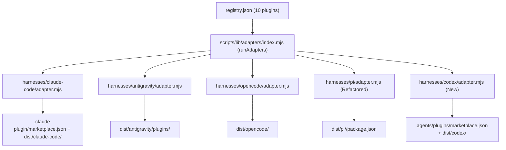

# Per-Plugin Pi Packaging and Codex Harness Adapter (`jskswamy/skills`)

*   **Author:** jskswamy
*   **Status:** Draft
*   **Date:** 2026-10-26

--------------------------------------------------------------------------------

## Overview

[jskswamy/skills](../../registry.json) builds 10 developer workflow plugins (`bivouac`, `codebase`, `commit-tools`, `craft`, `devenv`, `jot`, `refactor`, `sketch-note`, `study`, `typst-notes`) from canonical sources into harness-specific distributions under `dist/`. Today, `claude-code`, `antigravity`, and `opencode` each emit one self-contained directory per plugin (`dist/claude-code/<plugin>`, `dist/antigravity/plugins/<plugin>`, `dist/opencode/<plugin>`), whereas `pi` emits a single combined package at `dist/pi/` and `codex` has no harness adapter.

This design updates `jskswamy/skills` so all 5 target harnesses (`claude-code`, `antigravity`, `opencode`, `pi`, and `codex`) emit a uniform per-plugin distribution under `dist/`. Companion changes in `skillshare` and `nix-modules` to consume these outputs are deferred to a separate session.

## The Problem

Two gaps inside `jskswamy/skills` prevent every plugin in `registry.json` from having a per-plugin package across all 5 harnesses:

1.  **Aggregate `dist/pi` Instead of Per-Plugin `dist/pi/<plugin>`**:
    [`harnesses/pi/adapter.mjs`](../../harnesses/pi/adapter.mjs) currently merges all 10 plugins into one aggregate package at `dist/pi/package.json` with a single `dist/pi/hooks.manifest.json`. Because plugin managers (such as `skillshare`) bind and install plugins individually by plugin name, `pi` cannot be bound per plugin. In addition, [`scripts/changed-plugins.mjs`](../../scripts/changed-plugins.mjs) has to skip `pi` because `dist/pi/` does not have a `<pluginsDir>/<plugin>` directory structure.
2.  **Missing Codex Harness Adapter (`harnesses/codex/`)**:
    `jskswamy/skills` only registers `[claudeCode, antigravity, opencode, pi]` in [`scripts/lib/adapters/index.mjs`](../../scripts/lib/adapters/index.mjs). It does not emit `dist/codex/<plugin>/.codex-plugin/plugin.json` or the root `.agents/plugins/marketplace.json` catalog required by Codex CLI and `skillshare`.

## Goals

*   **G1 — Per-Plugin Pi Packages (`dist/pi/<plugin>`)**: Refactor [`harnesses/pi/adapter.mjs`](../../harnesses/pi/adapter.mjs) to set `pluginsDir = "dist/pi"` and emit one self-contained Pi package per enabled plugin at `dist/pi/<plugin>/package.json`, replacing the aggregate `dist/pi/package.json` and root `package.json#pi`.
*   **G2 — Conditional Pi Manifest Keys & Zero Empty Hook Runtimes**: In each `dist/pi/<plugin>/package.json`, include `"prompts": ["./prompts"]` only when the plugin has commands (so command-less plugins like `devenv` pass [`validatePiPackage`](../../scripts/lib/pi-package.mjs)), and copy `runtime/pi/` + write `hooks.manifest.json` + include `"extensions": ["./runtime/pi/runtime.mjs"]` only when the plugin has carried hooks (`carried.length > 0`), avoiding 6 no-op extension runtimes for hookless plugins.
*   **G3 — Remove Aggregate Pi Special Cases**: Remove the aggregate `"pi"` block and `"pi-package"` keyword from root [`package.json`](../../package.json), remove the root `package.json` copy in [`scripts/build.mjs`](../../scripts/build.mjs), and validate each plugin's `dist/pi/<plugin>/package.json` directly via `harnesses/pi/adapter.mjs#validate`.
*   **G4 — Codex Harness Adapter (`harnesses/codex/`)**: Add `harnesses/codex/adapter.mjs` (`id = "codex"`, `pluginsDir = "dist/codex"`) generating root `.agents/plugins/marketplace.json` and per-plugin `dist/codex/<plugin>/.codex-plugin/plugin.json`, converting slash commands to `<plugin>-cmd-<command>` skills via [`commandToSkill`](../../scripts/lib/transforms/command-to-skill.mjs), reporting `agents` as `degraded`, and returning `{ notApplicable }` for hooks in `canCarry`.
*   **G5 — Release Diffing & Validation Coverage**: Enable `"codex": { "enabled": true }` for all 10 plugins in [`registry.json`](../../registry.json), include `pi` and `.agents/plugins/marketplace.json` in [`scripts/changed-plugins.mjs`](../../scripts/changed-plugins.mjs), and pass `npm test` and `npm run validate`.

## Non-Goals

*   **NG1**: Modifying `skillshare` (`internal/plugin`) or `nix-modules` in this session (deferred to a separate session).
*   **NG2**: Changing the existing `claude-code`, `antigravity`, or `opencode` adapter output formats in `jskswamy/skills`.

## Open Questions

*   None.

## Critical User Journeys (CUJs)

### CUJ 1: Building and Validating All 5 Harnesses in `jskswamy/skills`

*   **Given**: All 10 plugins in `registry.json` have `claude-code`, `antigravity`, `opencode`, `pi`, and `codex` enabled.
*   **When**: The developer runs `npm run build:release`, `npm run validate`, and `npm test`.
*   **Then**:
    *   `dist/pi/<plugin>/package.json` exists for all 10 plugins and passes `validatePiPackage`.
    *   Only the 4 plugins with hooks (`codebase`, `commit-tools`, `craft`, `devenv`) contain `dist/pi/<plugin>/runtime/pi/runtime.mjs` and `hooks.manifest.json`.
    *   `dist/codex/<plugin>/.codex-plugin/plugin.json` exists for all 10 plugins and `.agents/plugins/marketplace.json` lists all 10 plugins at the repository root.

### CUJ 2: Installing a Single Pi or Codex Plugin from `dist/`

*   **Given**: A built checkout of `jskswamy/skills`.
*   **When**: A user or plugin manager installs `dist/pi/commit-tools` into Pi (`pi install <checkout>/dist/pi/commit-tools`) or installs `commit-tools` from `.agents/plugins/marketplace.json` into Codex.
*   **Then**:
    *   Pi loads `commit-tools`'s skills (`commit-action`, `commit-style`, `review-commits`, `validate-commits`), prompt (`/commit`), and pre-tool/session-start hooks from `dist/pi/commit-tools/` in isolation.
    *   Codex loads `commit-tools` from `dist/codex/commit-tools/` with its 4 canonical skills plus the converted `commit-tools-cmd-commit` skill.

--------------------------------------------------------------------------------

## Technical Plan (Architecture)

### Build Pipeline Data Flow



### 1. Per-Plugin Pi Harness Adapter (`harnesses/pi/adapter.mjs`)

[`harnesses/pi/adapter.mjs`](../../harnesses/pi/adapter.mjs) is converted from an aggregate root-level builder into a per-plugin builder matching [`harnesses/opencode/adapter.mjs`](../../harnesses/opencode/adapter.mjs):

*   **Exports**:
    *   `export const id = "pi";`
    *   `export const pluginsDir = "dist/pi";` (enables automatic per-plugin diffing in [`scripts/changed-plugins.mjs`](../../scripts/changed-plugins.mjs)).
*   **`generateRoot({ outRoot, plugins })`**:
    *   Removes `<outRoot>/dist/pi`.
    *   Returns `{ promptName: commandNames(plugins) }` so colliding command names across plugins (`jot` and `study` both define `setup`) continue to receive disambiguated prompt filenames (`jot-setup.md`, `study-setup.md`) when multiple per-plugin Pi packages are installed together.
*   **`generate({ repoRoot, outRoot, model, state, report })`**:
    *   Target directory: `const pluginRoot = join(outRoot, pluginsDir, model.name)`.
    *   **Resource Layout**: Copies `wrapperLayout(model)` filtered to exclude `commands`, `agents`, and canonical `hooks/hooks.json` (`({ kind, from }) => !["commands", "agents"].includes(kind) && !(kind === "hooks" && from.endsWith("hooks.json"))`), preserving each file's wrapper-relative `to` path (same layout as `claude-code`, `antigravity`, and `opencode`) so `${CLAUDE_PLUGIN_ROOT}` in hook commands rewrites cleanly to `"${PI_PACKAGE_ROOT}"` via `rewritePluginRoot(entry.command, ROOT_TOKEN)`.
    *   **Prompts (`commands`)**: When `model.commands.length > 0`, creates `<pluginRoot>/prompts/` and writes `<state.promptName(model.name, command.name)>.md` with `description`/`argument-hint` frontmatter and `$ARGUMENTS` fallback.
    *   **Agents**: Reports each agent in `model.agents` as `degraded` (`"Pi has no sub-agents"`).
    *   **Hooks (`carried`)**: Calls `carryHooks({ repoRoot, model, harness: id, canCarry, report })`. Verify each carried hook's `pluginRootPaths(entry.command)` exists inside `pluginRoot`.
        *   When `carried.length > 0`: copies `RUNTIME` into `pluginRoot`, and writes `<pluginRoot>/hooks.manifest.json` (`{ entries: hooks }`).
        *   When `carried.length === 0`: skips copying `RUNTIME` and skips writing `hooks.manifest.json`.
    *   **Per-Plugin `package.json`**: Writes `<pluginRoot>/package.json`:
        ```json
        {
          "name": "@jskswamy/pi-<plugin>",
          "version": "<model.version>",
          "private": true,
          "type": "module",
          "description": "<model.description>",
          "keywords": ["pi-package", ...model.tags],
          "pi": {
            "skills": ["./skills"],
            "prompts": ["./prompts"],
            "extensions": ["./runtime/pi/runtime.mjs"]
          }
        }
        ```
        where `"skills"` is included only when `model.skills.length > 0`, `"prompts"` only when `model.commands.length > 0`, and `"extensions"` only when `carried.length > 0`.
*   **`validate({ repoRoot, outRoot = repoRoot, plugin })`**:
    *   Reads `<outRoot>/dist/pi/<plugin.name>/package.json`, runs [`validatePiPackage`](../../scripts/lib/pi-package.mjs) against `<outRoot>/dist/pi/<plugin.name>`, and verifies that every script referenced in `hooks.manifest.json` (when present) exists on disk.

### 2. Codex Harness Adapter (`harnesses/codex/adapter.mjs`)

Codex CLI natively loads plugins from `.agents/plugins/marketplace.json` (at the repository root) where each entry points to a plugin directory containing `.codex-plugin/plugin.json`, `skills/`, and optional `.mcp.json` / `.app.json`.

*   **Exports**:
    *   `export const id = "codex";`
    *   `export const pluginsDir = "dist/codex";`
    *   `export const capabilities = { skills: { mode: "native" }, commands: { mode: "as-skill" }, agents: { mode: "none" }, hooks: { mode: "none", events: [] } };`
*   **`generateRoot({ outRoot, registry, plugins })`**:
    *   Removes `<outRoot>/dist/codex`.
    *   Writes `<outRoot>/.agents/plugins/marketplace.json` with `name: registry.marketplace.name`, `owner: registry.marketplace.owner`, `metadata: { description: registry.marketplace.description }`, and `plugins` entries mapping each enabled plugin to `source: "./dist/codex/<plugin.name>"` (matching the schema of `.claude-plugin/marketplace.json` in [`harnesses/claude-code/adapter.mjs`](../../harnesses/claude-code/adapter.mjs)).
*   **`generate({ repoRoot, outRoot, model, report })`**:
    *   Target directory: `const pluginRoot = join(outRoot, pluginsDir, model.name)`.
    *   Writes `<pluginRoot>/.codex-plugin/plugin.json` with `{ name: model.name, version: model.version, description: model.description, author: model.author, keywords: model.tags }`.
    *   Copies `wrapperLayout(model)` filtered to exclude `commands`, `agents`, and `hooks` (retaining `skills`, `templates`, and `extra` files such as `.mcp.json` and scripts).
    *   Converts each command in `model.commands` into `<pluginRoot>/skills/<plugin>-cmd-<command>/SKILL.md` using [`commandToSkill`](../../scripts/lib/transforms/command-to-skill.mjs) and `commandSkillName(model.name, command.name)` (shared with `antigravity`).
    *   Reports each agent in `model.agents` as `degraded` (`"Codex plugins do not support sub-agents"`).
    *   Calls `carryHooks({ repoRoot, model, harness: id, canCarry, report })` where `canCarry()` returns `{ notApplicable: "Codex plugins do not support lifecycle hooks" }` so the build's strict hook policy records hooks as not applicable rather than failing.
*   **`validate({ outRoot = repoRoot, plugin })`**:
    *   Verifies `<outRoot>/dist/codex/<plugin.name>/.codex-plugin/plugin.json` has valid `name`, `version`, and `description`, and that all canonical skills and converted `<plugin>-cmd-<command>` skills exist under `skills/`.

### 3. Build, Validation, and Release Diff Pipeline Updates

*   **[`scripts/lib/adapters/index.mjs`](../../scripts/lib/adapters/index.mjs)**:
    *   Import `* as codex from "../../../harnesses/codex/adapter.mjs"` and add `codex` to `ADAPTERS = [claudeCode, antigravity, opencode, pi, codex]`.
*   **[`scripts/changed-plugins.mjs`](../../scripts/changed-plugins.mjs)**:
    *   Because `harnesses/pi/adapter.mjs` and `harnesses/codex/adapter.mjs` both export `pluginsDir`, the existing loop over `adapters.map((a) => a.pluginsDir).filter(Boolean)` automatically diffs `dist/pi/<plugin>` and `dist/codex/<plugin>`.
    *   Change `MARKETPLACE` from a single string to `const MARKETPLACES = [".claude-plugin/marketplace.json", ".agents/plugins/marketplace.json"]` so marketplace metadata changes in either catalog mark the affected plugin as changed.
*   **[`scripts/build.mjs`](../../scripts/build.mjs) & [`scripts/validate.mjs`](../../scripts/validate.mjs) & [`package.json`](../../package.json)**:
    *   Remove `"pi"` and `"pi-package"` from root `package.json`.
    *   Remove the root `package.json` copy from `scripts/build.mjs` and the root `validatePiPackage` call from `scripts/validate.mjs` (per-plugin Pi packages are now validated in `harnesses/pi/adapter.mjs#validate`).
*   **[`registry.json`](../../registry.json)**:
    *   Add `"codex": { "enabled": true }` to `harnesses` for all 10 plugins.

--------------------------------------------------------------------------------

## Alternatives Considered

### Alternative A: Keep the Aggregate `dist/pi/` Package Alongside Per-Plugin `dist/pi/<plugin>/` Packages

*   **Pros**: Preserves direct `pi install git:github.com/jskswamy/skills` installation from the repository root without specifying a plugin subfolder.
*   **Cons**:
    1. Nests 10 per-plugin directories directly inside the aggregate `dist/pi/` package root (`dist/pi/skills/`, `dist/pi/prompts/`, `dist/pi/runtime/` alongside `dist/pi/bivouac/`, `dist/pi/craft/`, etc.), contaminating the aggregate package directory.
    2. Breaks [`scripts/changed-plugins.mjs`](../../scripts/changed-plugins.mjs), which enumerates `subdirs(adapter.pluginsDir)` and would mistake `skills/`, `prompts/`, `runtime/`, and `hooks/` for plugin names.
    3. Duplicates every skill, prompt, template, and font file twice inside `dist/pi/`.
*   **Reason for Rejection**: Per-plugin `dist/pi/<plugin>/` packages provide a uniform `<pluginsDir>/<plugin>` layout across all 5 harnesses, integrate directly with `changed-plugins.mjs`, and eliminate duplicate files.

### Alternative B: Co-Locate All Harness Manifests in a Single `dist/plugins/<plugin>` Directory

*   **Pros**: A single marketplace entry per plugin would contain `.claude-plugin/plugin.json`, `.codex-plugin/plugin.json`, `.antigravity-plugin/plugin.json`, and `package.json` (`pi` + `opencode`).
*   **Cons**:
    1. Harnesses require conflicting files at the same relative paths: `antigravity` strips `tools: "*"` from `agents/<name>.md` and adds converted `<plugin>-cmd-<command>` skills into `skills/`, whereas `claude-code` requires the canonical `agents/<name>.md` (with `tools` and `<example>` blocks) and reads `commands/` natively.
    2. Combining OpenCode and Pi into a single directory ships Node.js runtime files (`runtime/opencode/`, `runtime/pi/`, `index.js`) inside Claude Code, Codex, and Antigravity plugin bundles, violating `antigravity`'s zero-JavaScript invariant.
*   **Reason for Rejection**: Keeping `dist/<harness>/<plugin>` isolated preserves each harness's exact file layout and runtime boundary without cross-harness pollution.

### Alternative C: Copy `commands/` and `agents/` Directly into `dist/codex/<plugin>`

*   **Pros**: Minimal code in `harnesses/codex/adapter.mjs` (identical to `harnesses/claude-code/adapter.mjs`).
*   **Cons**: Codex CLI plugins only load `skills/`, `.mcp.json`, and `.app.json`. Copying `commands/` and `agents/` ships dead files that Codex ignores and leaves all slash commands (`/commit`, `/bivouac`, `/craft:*`) unavailable to Codex users.
*   **Reason for Rejection**: Converting `commands/` into `<plugin>-cmd-<command>` skills via [`commandToSkill`](../../scripts/lib/transforms/command-to-skill.mjs) (the same transform used by `harnesses/antigravity/adapter.mjs`) makes all plugin slash commands work natively in Codex.

--------------------------------------------------------------------------------

## Non-Functional Requirements

*   **Performance & Runtime Overhead**: In `harnesses/pi/adapter.mjs`, the Pi extension runtime (`runtime/pi/runtime.mjs`) and `hooks.manifest.json` must only be emitted for plugins with `carried.length > 0` (`codebase`, `commit-tools`, `craft`, `devenv`). The 6 hookless plugins must not register no-op `session_start`, `tool_call`, `tool_result`, or `agent_settled` listeners in Pi.
*   **Storage Footprint**: Dropping the aggregate `dist/pi/` tree in favor of per-plugin `dist/pi/<plugin>` keeps the total repository file count and byte size well below `skillshare`'s 20,000-file / 100 MiB source safety ceiling (`hashTree`).
*   **Determinism & Hermetic Builds**: Running `npm run build` (into a temporary directory) and `npm run build:release` (into `repoRoot`) must produce byte-identical output across repeated runs, and `node scripts/changed-plugins.mjs` must return an empty list immediately after `npm run build:release`.

--------------------------------------------------------------------------------

## Detailed Implementation Plan

### Target Files to Create/Modify/Delete

#### 1. [`harnesses/pi/adapter.mjs`](../../harnesses/pi/adapter.mjs) (Modify)

*   **Type / Scope**: Harness Build Adapter (JavaScript ES Module)
*   **Proposed Changes**:
    *   Export `export const pluginsDir = "dist/pi";` (replacing `const OUT = "dist/pi"`).
    *   In `generateRoot({ outRoot, plugins })`, remove `join(outRoot, pluginsDir)` and return `{ promptName: commandNames(plugins) }` (removing root-level `PROMPTS` creation and root-level `copyRuntime`).
    *   In `generate({ repoRoot, outRoot, model, state, report })`:
        *   Set `const out = join(outRoot, pluginsDir, model.name)`.
        *   Filter `wrapperLayout(model)` to exclude `commands`, `agents`, and `hooks/hooks.json`, and copy to `out` at wrapper-relative paths (`to` instead of `from`) so `${CLAUDE_PLUGIN_ROOT}` rewrites to `"${PI_PACKAGE_ROOT}"` via `rewritePluginRoot`.
        *   When `model.commands.length > 0`, create `join(out, "prompts")` and write each prompt template `<state.promptName(model.name, command.name)>.md`.
        *   Report `model.agents` as `degraded` (`"Pi has no sub-agents"`).
        *   Carry hooks via `carryHooks`; validate each hook script exists in `layout` via `canonicalPluginPaths(entry.command, layout, "")` and rewrite `${CLAUDE_PLUGIN_ROOT}` via `rewritePluginRoot(entry.command, ROOT_TOKEN)`.
        *   When `hooks.length > 0`, copy `RUNTIME` to `out` and write `join(out, "hooks.manifest.json")` (`{ entries: hooks }`).
        *   Write `join(out, "package.json")` with `name: "@jskswamy/pi-${model.name}"`, `version: model.version`, `private: true`, `type: "module"`, `description: model.description`, `keywords: ["pi-package", ...(model.tags ?? [])]`, and a `pi` object containing `skills: ["./skills"]` (when `model.skills.length > 0`), `prompts: ["./prompts"]` (when `model.commands.length > 0`), and `extensions: ["./runtime/pi/runtime.mjs"]` (when `hooks.length > 0`).
    *   Remove `finish()` (no aggregate manifest or aggregate `package.json`).
    *   Update `validate({ outRoot = repoRoot, plugin })` to validate `join(outRoot, pluginsDir, plugin.name, "package.json")` via `validatePiPackage` and verify any `hooks.manifest.json` script targets exist.
*   **Rationale**: Converts Pi from a single aggregate package into per-plugin packages under `dist/pi/<plugin>`, avoiding empty hook runtimes on hookless plugins and enabling per-plugin installation and diffing.

#### 2. [`harnesses/codex/adapter.mjs`](../../harnesses/codex/adapter.mjs) (Create)

*   **Type / Scope**: Harness Build Adapter (JavaScript ES Module)
*   **Proposed Changes**:
    *   Export `id = "codex"`, `pluginsDir = "dist/codex"`, and `capabilities = { skills: { mode: "native" }, commands: { mode: "as-skill" }, agents: { mode: "none" }, hooks: { mode: "none", events: [] } }`.
    *   In `generateRoot({ outRoot, registry, plugins })`, remove `join(outRoot, pluginsDir)` and write `join(outRoot, ".agents", "plugins", "marketplace.json")` with `source: "./dist/codex/${plugin.name}"` for each enabled plugin.
    *   In `generate({ repoRoot, outRoot, model, report })`, write `join(outRoot, pluginsDir, model.name, ".codex-plugin", "plugin.json")`, copy `wrapperLayout(model)` excluding `commands`, `agents`, and `hooks`, convert `model.commands` into `skills/<plugin>-cmd-<command>/SKILL.md` via `commandToSkill`, report `model.agents` as `degraded`, and run `carryHooks` with `canCarry` returning `{ notApplicable: "Codex plugins do not support lifecycle hooks" }`.
    *   In `validate({ outRoot = repoRoot, plugin })`, verify `.codex-plugin/plugin.json` fields (`name`, `version`, `description`) and expected `skills/` directories.
*   **Rationale**: Adds native Codex plugin generation and root marketplace catalog so Codex CLI and `skillshare` can discover and install all 10 plugins.

#### 3. [`harnesses/codex/README.md`](../../harnesses/codex/README.md) (Create)

*   **Type / Scope**: EGM Architectural Contract & Harness Documentation
*   **Proposed Changes**: Document `harnesses/codex` (`Overview`, `Interface`, `Invariants`, `Side Effects`, `Verification`, and `Install` instructions).
*   **Rationale**: Maintains EGM contract coverage across all harness directories.

#### 4. [`scripts/lib/adapters/index.mjs`](../../scripts/lib/adapters/index.mjs) (Modify)

*   **Type / Scope**: Adapter Registry
*   **Proposed Changes**: Import `* as codex from "../../../harnesses/codex/adapter.mjs"` and append `codex` to `ADAPTERS = [claudeCode, antigravity, opencode, pi, codex]`.
*   **Rationale**: Registers the `codex` adapter in the build, validation, and `changed-plugins` pipelines.

#### 5. [`registry.json`](../../registry.json) (Modify)

*   **Type / Scope**: Plugin Registry Configuration
*   **Proposed Changes**: Add `"codex": { "enabled": true }` under `harnesses` for all 10 plugins (`bivouac`, `codebase`, `commit-tools`, `craft`, `devenv`, `jot`, `refactor`, `sketch-note`, `study`, `typst-notes`).
*   **Rationale**: Opts all 10 plugins into the `codex` harness build.

#### 6. [`package.json`](../../package.json) (Modify)

*   **Type / Scope**: Repository Package Manifest
*   **Proposed Changes**: Remove the root `"pi"` block and `"pi-package"` keyword.
*   **Rationale**: Root `package.json` is no longer an aggregate Pi package; each plugin is packaged under `dist/pi/<plugin>/package.json`.

#### 7. [`scripts/build.mjs`](../../scripts/build.mjs) (Modify)

*   **Type / Scope**: Build CLI Script
*   **Proposed Changes**: Remove the root `package.json` copy (`copyFile(join(repoRoot, "package.json"), join(outRoot, "package.json"))`) and the `existsSync(join(values.out, "package.json"))` guard that only existed for the root aggregate Pi package.
*   **Rationale**: Eliminates the aggregate Pi special case in non-release builds.

#### 8. [`scripts/validate.mjs`](../../scripts/validate.mjs) (Modify)

*   **Type / Scope**: Validation CLI Script
*   **Proposed Changes**: Remove the root `package.json` read and root `validatePiPackage({ repoRoot: outRoot, packageJson })` call (per-plugin `dist/pi/<plugin>/package.json` files are validated by `harnesses/pi/adapter.mjs#validate` in the `enabledAdapters(plugin)` loop). Update `tests/build/validate-cli.test.mjs` `sourcesOnly()` cleanup list to also remove `.agents`.
*   **Rationale**: Aligns Pi validation with the per-plugin adapter validation model.

#### 9. [`scripts/changed-plugins.mjs`](../../scripts/changed-plugins.mjs) (Modify)

*   **Type / Scope**: Release Diff CLI Script
*   **Proposed Changes**: Replace `const MARKETPLACE = ".claude-plugin/marketplace.json"` with `const MARKETPLACES = [".claude-plugin/marketplace.json", ".agents/plugins/marketplace.json"]` and compare plugin entries across both catalogs. Update header comments noting that all 5 harnesses use `pluginsDir`.
*   **Rationale**: Ensures changes to `.agents/plugins/marketplace.json` or `dist/pi/<plugin>` / `dist/codex/<plugin>` are detected for release version bumping.

#### 10. [`tests/build/pi-adapter.test.mjs`](../../tests/build/pi-adapter.test.mjs) & [`tests/build/pi-commit-tools.test.mjs`](../../tests/build/pi-commit-tools.test.mjs) & [`tests/build/build-cli.test.mjs`](../../tests/build/build-cli.test.mjs) & [`tests/build/validate-cli.test.mjs`](../../tests/build/validate-cli.test.mjs) (Modify)

*   **Type / Scope**: Unit & Integration Tests
*   **Proposed Changes**:
    *   Update `tests/build/pi-adapter.test.mjs` to assert per-plugin output under `dist/pi/<plugin>/` (`dist/pi/one/package.json`, `dist/pi/one/prompts/`, `dist/pi/one/hooks.manifest.json`, `dist/pi/one/runtime/pi/runtime.mjs`), verify hookless plugins omit `runtime/` and `extensions`, and verify command-less plugins omit `prompts`.
    *   Update `tests/build/pi-commit-tools.test.mjs` to load `dist/pi/commit-tools` instead of aggregate `dist/pi`.
    *   Update `tests/build/build-cli.test.mjs` to check `.claude-plugin/marketplace.json` and `.agents/plugins/marketplace.json` instead of root `package.json` copy.
    *   Update `tests/build/validate-cli.test.mjs` to strip `.agents` alongside `.claude-plugin` and `dist` when preparing `sourcesOnly()`.
*   **Rationale**: Keeps test suite aligned with per-plugin Pi output and root Codex marketplace generation.

#### 11. [`tests/build/codex-adapter.test.mjs`](../../tests/build/codex-adapter.test.mjs) (Create)

*   **Type / Scope**: Unit Test
*   **Proposed Changes**: Test `harnesses/codex/adapter.mjs` generation of `.agents/plugins/marketplace.json`, `dist/codex/<plugin>/.codex-plugin/plugin.json`, `commandToSkill` conversion (`<plugin>-cmd-<command>`), `agents` degradation reporting, `hooks` `notApplicable` policy handling, and `validate()`.
*   **Rationale**: Verifies the new `codex` harness adapter contract.

#### 12. [`harnesses/README.md`](../../harnesses/README.md), [`harnesses/pi/README.md`](../../harnesses/pi/README.md), [`scripts/README.md`](../../scripts/README.md), [`scripts/lib/adapters/README.md`](../../scripts/lib/adapters/README.md) (Modify) & Release Output `dist/` / `.agents/plugins/marketplace.json` (Regenerate)

*   **Type / Scope**: Documentation Contracts & Built Release Artifacts
*   **Proposed Changes**:
    *   Update the EGM `README.md` contracts in `harnesses/`, `harnesses/pi/`, `scripts/`, and `scripts/lib/adapters/` to reflect per-plugin `dist/pi/<plugin>` and the new `codex` adapter.
    *   Run `npm run build:release` to replace the aggregate `dist/pi/` files with `dist/pi/<plugin>/` and generate `dist/codex/<plugin>/` + `.agents/plugins/marketplace.json`.
*   **Rationale**: Keeps EGM contracts and committed `dist/` artifacts in sync with source changes.

### Verification Plan

*   **Compilation/Build**: `npm run build` and `npm run build:release` in `/Users/subramk/source/github.com/jskswamy/skills` exit `0` with zero uncarried resource errors.
*   **Validation**: `npm run validate` exits `0` (`Validation passed`).
*   **Unit & Integration Tests**: `npm test` passes all test suites in `tests/build/*.test.mjs`.
*   **Release Diff Check**: `node scripts/changed-plugins.mjs` exits `0` with empty output after `npm run build:release`.

--------------------------------------------------------------------------------

*Drafted with EGM*
