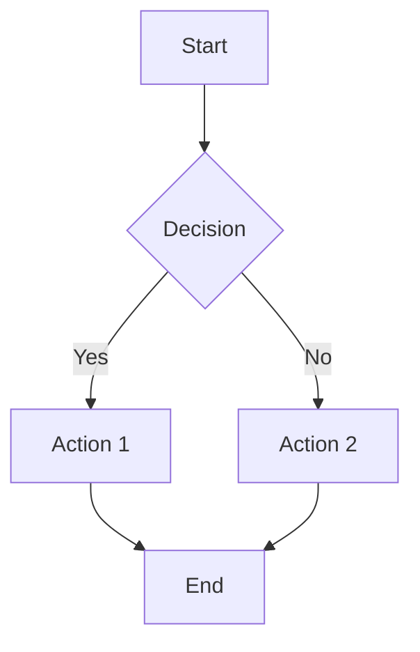
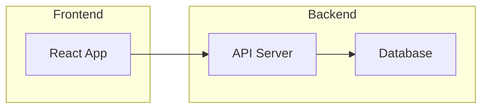
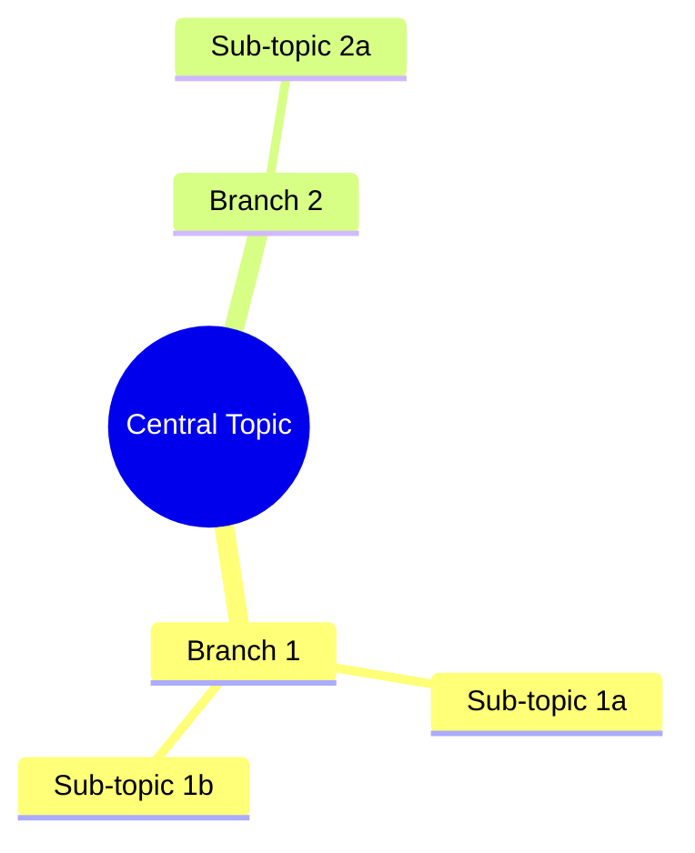
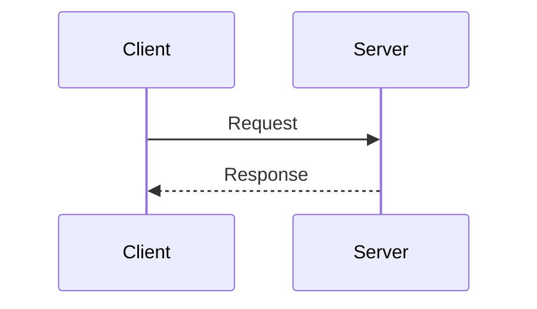

# Direct PNG Generation (Mermaid Workflow)

## Steps 8-direct and 9-direct

### Step 8-direct: Generate Mermaid Diagram Definition

Convert the content (from Step 3) into Mermaid diagram syntax.

**For flowcharts/processes:**


**For architecture diagrams:**


**For mind maps:**


**For sequence diagrams:**


**Style configuration for hand-drawn look:**
```json
{
  "theme": "default",
  "look": "handDrawn",
  "themeVariables": {
    "fontFamily": "Virgil, Comic Sans MS, cursive"
  }
}
```

### Step 9-direct: Generate PNG with Mermaid CLI

1. **Write the Mermaid definition to a temp file:**
   ```bash
   cat > /tmp/sketch-{timestamp}.mmd << 'EOF'
   {mermaid-definition}
   EOF
   ```

2. **Create config for hand-drawn style:**
   ```bash
   cat > /tmp/mermaid-config.json << 'EOF'
   {
     "theme": "default",
     "look": "handDrawn"
   }
   EOF
   ```

3. **Generate PNG based on `mermaid_runner`:**

   **If `mermaid_runner: global`:**
   ```bash
   mmdc -i /tmp/sketch-{timestamp}.mmd \
        -o "${workbench_path}/sketches/{filename}.png" \
        -c /tmp/mermaid-config.json \
        -s {png_scale} \
        -b transparent
   ```

   **If `mermaid_runner: nix`:**
   ```bash
   nix-shell -p mermaid-cli --run "mmdc -i /tmp/sketch-{timestamp}.mmd \
        -o \"${workbench_path}/sketches/{filename}.png\" \
        -c /tmp/mermaid-config.json \
        -s {png_scale} \
        -b transparent"
   ```

   **If `mermaid_runner: npx`:**
   ```bash
   npx -y @mermaid-js/mermaid-cli@12.0.0 -i /tmp/sketch-{timestamp}.mmd \
        -o "${workbench_path}/sketches/{filename}.png" \
        -c /tmp/mermaid-config.json \
        -s {png_scale} \
        -b transparent
   ```

   **Scale mapping:**
   - `png_scale: 1` → `-s 1`
   - `png_scale: 2` → `-s 2`
   - `png_scale: 4` → `-s 4`

4. **Clean up temp files:**
   ```bash
   rm /tmp/sketch-{timestamp}.mmd /tmp/mermaid-config.json
   ```

5. **If generation fails:**
   - Show error message
   - Offer to create Excalidraw file instead as fallback

**Skip to Step 10** for success message.
